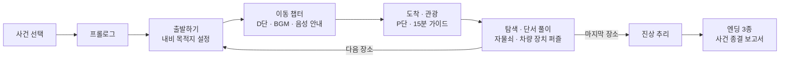
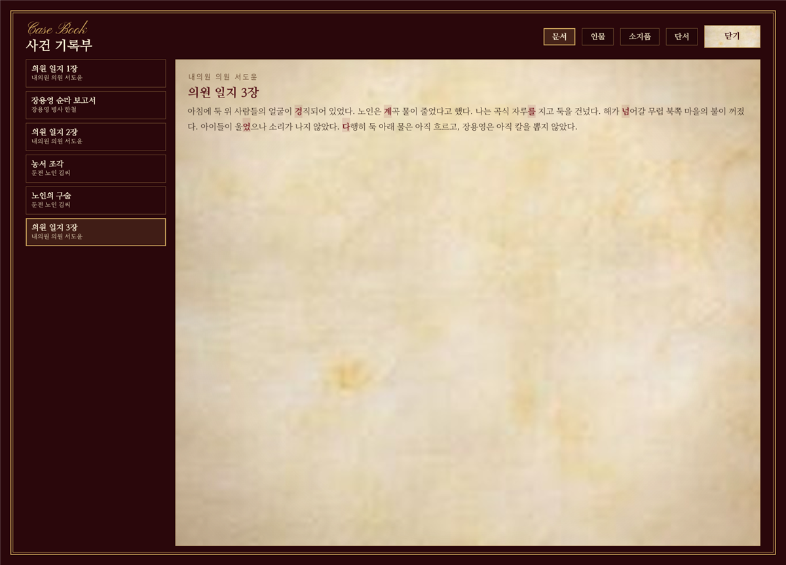

<div align="center">


# Escape Road · 이스케이프 로드

**Escape Room에서 Escape Road로, 도시 전체를 무대로 달리는 스토리 방탈출 여행 패키지**

`Pleos Connect` · `Android Automotive (API 34)` · `Kotlin` · `Jetpack Compose`

현대자동차그룹 차량용 앱 개발 공모전 출품작 · 팀 D2E (Drive to Escape)

[▶ 시연 영상](https://www.youtube.com/watch?v=8HCgqPB_IQw) · [📦 APK 다운로드](https://github.com/aemizastudy-oss/EscapeRoad/releases/tag/v0.4.0) · [실행 방법](#7-실행-방법)

</div>

<p align="center">
  
</p>

> [!NOTE]
> **현재 상태:** v0.4.0 · `release/v0.4.0` 브랜치 · Pleos Connect 에뮬레이터(v2.1.0, API 34, 2560×1440)에서 확인했습니다. **실차에서는 아직 확인하지 않았습니다.** 확인한 범위와 확인하지 않은 범위는 [검증 상태](#6-검증-상태)에 나눠 적었습니다.

## 🎬 시연 영상

<p align="center">
  <a href="https://www.youtube.com/watch?v=8HCgqPB_IQw">
    
  </a>
  <br>
  <b>▶ <a href="https://www.youtube.com/watch?v=8HCgqPB_IQw">YouTube에서 시연 영상 보기</a></b>
</p>

## 목차

1. [한눈에 보기](#1-한눈에-보기)
2. [왜 만들었나](#2-왜-만들었나)
3. [플레이 흐름](#3-플레이-흐름)
4. [핵심 기능](#4-핵심-기능)
5. [Pleos SDK 활용](#5-pleos-sdk-활용)
6. [검증 상태](#6-검증-상태)
7. [실행 방법](#7-실행-방법) (APK · 테스트 환경 · 설정)
8. [프로젝트 구조](#8-프로젝트-구조)
9. [발전 방향](#9-발전-방향-pleos-sdk로-넓히는-퍼즐)
10. [출처·라이선스](#10-출처라이선스)

---

## 1. 한눈에 보기

| 항목 | 내용 |
| --- | --- |
| 한 줄 소개 | Escape Room에서 Escape Road로, 도시 전체를 무대로 달리는 스토리 방탈출 여행 패키지 |
| 핵심 개념 | **차량의 콘텐츠화**: 이동 시간은 이야기, 주행 상태는 진행 신호, 차량 장치는 퍼즐 도구가 됨 |
| 안전 원칙 | **P단 플레이**: 주행 중에는 음성과 BGM만, 탐색과 풀이는 P단으로 정차했을 때만 |
| 시연 사건 | 수원 화성 「시역(屍疫)」 · 장소 5곳 · 자물쇠 23개 · 엔딩 3종 · 반나절 코스 |
| 앱 정보 | 앱 ID `com.team.carescape` · 버전 `0.4.0` (versionCode 4) |

## 2. 왜 만들었나

| 키워드 | 주목한 점 | 이스케이프 로드의 답 |
| --- | --- | --- |
| 차와 함께하는 여행 | 국내 여행의 84.5%가 자가용으로 이루어지지만(2025 국민여행조사), 차 안 콘텐츠는 대부분 **재생**에 머문다 | 차의 이동·데이터·장치를 콘텐츠 재료로 쓴다 |
| 무대의 확장 | 방탈출이 야외로 넓어졌지만 걸어서 하는 방식이라 **한 동네 코스**를 벗어나기 어렵다 | 차로 흩어진 명소를 하나의 **지역 기반 사건**으로 잇는다 |
| 여행 준비 부담 | 동선을 짜고 주차장·식당을 따로 찾아야 하며, 관광지는 안내판을 읽는 관람형이 많다 | 코스·이야기·주변 정보를 묶은 **사건**과 **여행 도우미** |
| 몰입형 드라이브 | 운전자는 주행 중 화면 콘텐츠에서 빠지게 된다 | 주행 중에는 **음성**, 정차 뒤에는 **다 함께 풀이** |

> "여행지에 가기 위해 차를 탄다"에서 **"여행하기 위해 차를 탄다"**로.

## 3. 플레이 흐름



| 사건 선택 | 사건 기록부 | 사건 종결 보고서 |
| :---: | :---: | :---: |
|  |  |  |

> Pleos Connect 에뮬레이터 Debug 빌드에서 찍은 화면입니다. 오른쪽 위 `시연 · SIM` 버튼은 Debug 전용이며 Release에는 없습니다.

📖 사건 「시역(屍疫)」의 전체 이야기와 장면 구성은 [**시역 스토리보드 (PDF)**](docs/story/siyeok-storyboard.pdf)에서 볼 수 있습니다.

## 4. 핵심 기능

### 🚗 P단 플레이 원칙

- 앱이 **기어·속도·운전 중 화면 제한(CarUx) 상태**를 직접 읽습니다. 탐색·자물쇠·여행 도우미는 `P단 + 정지 + CarUx 허용 + 앱 화면 표시` 조건을 모두 만족할 때만 열립니다.
- 풀이 도중 D단이 들어오면 즉시 차단 화면으로 바뀌고, 입력하던 답안은 초기화됩니다.
- 도착해도 앱 화면을 강제로 띄우지 않습니다. 중요도가 낮은 알림만 띄우고, 이용자가 정차한 뒤 눌러서 돌아옵니다.

### 🎧 이동 챕터

- **출발하기**를 누르면 NaviHelper로 다음 장소가 내비게이션 목적지로 설정됩니다.
- D단으로 출발하면 포그라운드 서비스가 **장소별 BGM**과 **진행자 음성**(출발할 때 1회, 도착 약 900m 전 1회)을 재생합니다.
- 내비 안내·통화·차량 음성이 나오면 앱 소리를 잠시 멈췄다가 이어서 재생합니다. 오른쪽 위 버튼으로 음성을 끌 수 있습니다.

### 🏯 도착 · 관광 · 탐색

- 장소마다 시간대가 다른 **사건 장면**과 **15분 관광 가이드**(꼭 볼 것 3가지·사진 명소)를 제공합니다.
- 관광을 시작하고 15분이 지나야 탐색이 열립니다. 차 안에서만 문제를 푸는 것을 막는 장치입니다.
- 탐색 장면에서 사물을 눌러 조사하고 자물쇠를 풉니다. 단서를 찾을수록 새로운 공간이 열립니다.

| ① 화성행궁 · 해 질 녘 | ② 화홍문 · 밤 | ③ 만석거 · 새벽 |
| :---: | :---: | :---: |
|  |  |  |
| **④ 수원광교박물관 · 2026년 수장고** | **⑤ 광교호수공원 · 아랫방죽** | |
|  |  | |

### 🔐 차량 장치 퍼즐: 차 안에서만 풀 수 있는 문제

| 장소 | 퍼즐 | 차량 장치 (Vehicle SDK) |
| --- | --- | --- |
| 화홍문 | 일곱 칸 판문을 오른쪽(닫기)·왼쪽(열기) 깜빡이로 차례로 정하기. 모두 닫으면 함정 | 방향지시등 (TurnSignal) |
| 수원광교박물관 | 앞·뒤 좌우 독서등을 켜서 봉화 올리기 | 독서등 4개 영역 (Light) |
| 광교호수공원 | 운전석 창문을 내려 물소리 듣기 | 창문 (Window) |

앱은 차량 상태를 **읽기만** 하고 차량을 제어하지 않습니다. 차량 장치 입력도 P단에서만 받습니다.

### 🧩 단서 · 힌트 · 엔딩

- **자물쇠:** 숫자·방향·색상·영어·한자 다이얼·시간 다이얼·소지품 사용 등 여러 형태가 있습니다. 화면의 **제출**을 눌렀을 때만 정답을 판정합니다.
- **소지품 · 사건 기록부:** 획득한 물건은 다른 장소에서 쓰고, 인물 일지와 문서는 사건 기록부의 문서·인물·소지품·단서 탭에서 다시 읽을 수 있습니다.
- **3단계 힌트 + 각성도:** 1단계는 방향 제시, 2단계는 구체적 단서, 3단계는 결정적 힌트입니다. 힌트 2·3단계와 함정은 각성도(10단계)를 올립니다.
- **엔딩 분기:** 각성도와 진상 추리 결과에 따라 진 엔딩 「연이의 이름」, 일반 엔딩 「한 장이 비어 있다」, 배드 엔딩 「호숫가의 그림자」로 나뉩니다.
- **저장 · 재개:** 진행·오답·힌트 기록을 기기에 저장합니다. 앱을 다시 켜면 **수사 재개**로 이어서 할 수 있습니다.
- **사건 종결 보고서:** 수사 시간·힌트·오답·각성도·장소별 기록을 한 장으로 정리하고 사진으로 저장합니다.

### 🧭 여행 도우미

| 탭 | 내용 |
| --- | --- |
| 일정 | 날짜·기간(당일치기~2박 3일)·관심사를 입력하면 사건 코스에 맞춘 일정 제공 |
| 장소 카드 | 직접 확인해 준비한 카드 40개(주차·맛집·카페·체험·숙소·야경). 주소와 출처 표기 |
| 15분 가이드 | 장소별 관람 체크리스트. 사건에 쓰이는 항목은 `사건 단서`로 표시하고 정답은 숨김 |
| 내 차 | Vehicle SDK로 읽은 배터리·연료·주행 가능 거리를 남은 코스와 비교해 충분/빠듯/충전 필요로 판정 |

- 공개 전인 마지막 장소는 스포일러를 막기 위해 가립니다.
- 길 안내는 **관광지 대표 지점까지** Pleos NaviHelper로 요청합니다. 식당이나 주차장 입구까지 안내하지는 않습니다.
- **외부 지도·검색 API를 쓰지 않습니다.** 앱(main) 코드에는 외부 서버와 통신하는 코드도 `INTERNET` 권한도 없습니다. 장소 카드의 공식 사이트 주소는 출처를 밝히려고 도메인만 글자로 보여주며, 앱이 접속하지는 않습니다.

## 5. Pleos SDK 활용

| SDK | 쓰는 곳 | 코드 |
| --- | --- | --- |
| **Vehicle** (2.3.2) | 주행 중 서비스의 기어 감지(D단 출발 → 이동 챕터 시작) | [DriveSignals.kt](app/src/main/java/com/team/carescape/drive/DriveSignals.kt) |
|  | 방향지시등 · 창문 · 와이퍼 상태 | [PleosVehiclePuzzleReader.kt](app/src/main/java/com/team/carescape/platform/sdk/PleosVehiclePuzzleReader.kt) |
|  | 독서등(Light) 봉화 퍼즐 | [PleosInteriorLightReader.kt](app/src/main/java/com/team/carescape/platform/sdk/PleosInteriorLightReader.kt) |
|  | 배터리 · 연료 · 주행 가능 거리 · 브레이크 | [PleosVehicleAssist.kt](app/src/main/java/com/team/carescape/platform/sdk/PleosVehicleAssist.kt) |
| **NaviHelper** (3.0.5) | 다음 장소 목적지 설정, 남은 거리 기반 안내 시점, 내비 화면 전환 | [PleosLocationNavigation.kt](app/src/main/java/com/team/carescape/platform/sdk/PleosLocationNavigation.kt) · [DriveSignals.kt](app/src/main/java/com/team/carescape/drive/DriveSignals.kt) |
| **FusedLocation** (1.1.3) | 장소 도착 판정, 주행 중 도착 감지 | [PleosLocationNavigation.kt](app/src/main/java/com/team/carescape/platform/sdk/PleosLocationNavigation.kt) · [DriveSignals.kt](app/src/main/java/com/team/carescape/drive/DriveSignals.kt) |
| **TextToSpeech** (3.3.1, ON_DEVICE) | 진행자 음성 (녹음 파일이 없을 때 사용) | [PleosSpeechAdapter.kt](app/src/main/java/com/team/carescape/platform/sdk/PleosSpeechAdapter.kt) · [DriveAudio.kt](app/src/main/java/com/team/carescape/drive/DriveAudio.kt) |
| **SpeechToText** (3.3.1, ON_DEVICE) | 연결 어댑터만 준비. 현재 사건에는 음성 입력 화면 없음 | [PleosSpeechAdapter.kt](app/src/main/java/com/team/carescape/platform/sdk/PleosSpeechAdapter.kt) |
| Android Car API | 앱 화면의 P단 · 속도 · CarUx 안전 판정 | [PleosCarSafety.kt](app/src/main/java/com/team/carescape/platform/sdk/PleosCarSafety.kt) |

- 사용하는 의존성은 [app/build.gradle.kts](app/build.gradle.kts), 권한은 [AndroidManifest.xml](app/src/main/AndroidManifest.xml)에서 확인할 수 있습니다.
- 음성은 기기 안에서만 처리합니다. 차량 마이크나 음성을 외부 서비스로 보내지 않습니다.
- SDK 연결·권한·제약의 자세한 내용은 [SDK 연결 안내](docs/sdk-ui-integration.md)와 [차량 퍼즐 SDK](docs/vehicle-puzzle-sdk.md)에 있습니다.

## 6. 검증 상태

| 구분 | 결과 |
| --- | --- |
| 빌드 | Debug · Release · 기기 테스트 APK 빌드 성공 |
| 단위 테스트 | **203개 통과** (실패 0) |
| LIVE SDK 완주 | Pleos 에뮬레이터와 Virtual Console로 실제 SDK 신호를 넣어 **자물쇠 23개를 전부 풀고 진 엔딩·저장·재개까지 확인** (위치 인증·15분 대기는 제외) |
| 차량 신호 수신 | 방향지시등 · 창문 · 독서등 4개 영역 · 와이퍼 · 기어/속도 값이 앱에 들어오는 것 확인 |
| 아직 확인하지 않은 것 | 실차 주행, 실제 관광지 방문 인증(위치 정확도 근거 부족으로 보류), 내비 길 안내 완료, 음질·음량 청취 확인, 서명된 Release APK |

자세한 날짜별 기록은 [검증 로그](docs/verification-log.md)에 있습니다.

## 7. 실행 방법

### 📦 APK

| 구분 | 위치 |
| --- | --- |
| 바로 설치 | **[GitHub Release v0.4.0](https://github.com/aemizastudy-oss/EscapeRoad/releases/tag/v0.4.0)** › `EscapeRoad-v0.4.0-debug.apk` (약 128MB, 시연 패널 포함 Debug 빌드) |
| 직접 빌드 | `app/build/outputs/apk/debug/app-debug.apk` (아래 빌드 명령 실행 후 생성) |

> APK가 GitHub 저장소 파일 크기 제한(100MB)을 넘어서 저장소가 아닌 Release에 올립니다.

### 🖥️ 개발·테스트 환경

| 항목 | 내용 |
| --- | --- |
| 에뮬레이터 | **Pleos Connect v2.1.0** (AVD `Pleos_Connect_v2.1.0`, x86_64) |
| OS | Android 14 (API 34), Android Automotive |
| 화면 규격 | **2560 × 1440** (가로), 160dpi |
| 개발 PC | Windows 11 · Android Studio (내장 JBR) |
| 빌드 설정 | compileSdk 36 · targetSdk 34 · minSdk 28 · Java 17 · AGP 9.0.1 |
| 차량 신호 테스트 | Pleos **Virtual Console** (방향지시등·창문·독서등·기어·속도 입력) |

### ⚙️ 필요한 설정

1. **Android Studio**에서 저장소 최상위 폴더를 열고 Gradle Sync를 합니다.
2. SDK Manager에서 **Android SDK Platform 36**을 설치합니다. `android.car` 라이브러리는 이 플랫폼에 들어 있습니다.
3. Pleos SDK는 [Pleos Maven 저장소](https://nexus-playground.pleos.ai/repository/maven-releases/)에서 받습니다. 이미 [settings.gradle.kts](settings.gradle.kts)에 등록돼 있어서 별도 계정 설정은 필요 없습니다.
4. `local.properties`에는 Android SDK 경로(`sdk.dir`)만 둡니다. Android Studio가 자동으로 만들고, 저장소에는 올리지 않습니다.
5. Pleos Connect 에뮬레이터(v2.1.0)를 설치하고 실행합니다.
6. 앱 권한(차량 조명·창문·주행 상태·위치·내비·TTS 등)은 [AndroidManifest.xml](app/src/main/AndroidManifest.xml)에 선언돼 있습니다. 에뮬레이터에서는 설치하면 바로 쓸 수 있습니다.

### ▶️ 빌드 · 설치 · 실행

```powershell
# Windows: 단위 테스트 + Debug APK 빌드
.\gradlew.bat :app:testDebugUnitTest :app:assembleDebug
```

```bash
# macOS / Linux (Ubuntu에서는 아직 실행해 보지 않음)
chmod +x gradlew
./gradlew :app:testDebugUnitTest :app:assembleDebug
```

```powershell
# 에뮬레이터에 설치하고 실행 (Pleos 에뮬레이터 사용자는 10번)
adb install -r app/build/outputs/apk/debug/app-debug.apk
adb shell am start --user 10 -n com.team.carescape/.MainActivity
```

- Android Studio에서는 `app` 실행 구성을 고르고 Pleos 에뮬레이터를 대상으로 **Run**하면 됩니다.
- 일반 Android 휴대폰에서는 Pleos 서비스와 차량 기능이 없어서 정상 동작을 보장하지 않습니다.

### 🎮 시연 방법 (Debug 빌드)

실제로 이동하지 않고 전체 흐름을 볼 수 있습니다.

1. 오른쪽 위 **시연 · SIM** 패널에서 **MOCK**과 **P 정차**를 선택합니다.
2. 사건 고르기 → 「시역」 → 프롤로그 → **출발하기**를 누르면 약 1분짜리 **시연 자동 주행**이 진행됩니다.
3. **시연 바로가기**로 도착 1~5, 장면 1~5, 마지막 공개, 엔딩 3종 중 원하는 지점으로 바로 이동할 수 있습니다.
4. 차량 장치 퍼즐은 SIM 패널 버튼이나 Pleos **Virtual Console**로 조작합니다. 자세한 방법은 [LIVE SDK 콘솔 테스트](docs/live-sdk-console-test.md)에 있습니다.

> Release 빌드에는 시연 패널·모의 P단·시간 생략 기능이 들어 있지 않습니다.

## 8. 프로젝트 구조

```text
app/src/main/java/com/team/carescape/
├── game/          # 사건 진행 엔진 · 「시역」 콘텐츠 · 자물쇠/퍼즐 판정 · 관광 정책
├── drive/         # 주행 중 포그라운드 서비스 · BGM/음성 · 도착 감지
├── platform/sdk/  # Pleos SDK · Android Car API 연결 (5번 표 참고)
├── travel/        # 여행 도우미 · 장소 카드 · 15분 가이드 · 내 차 계획
├── data/          # 여행 진행 저장 (DataStore)
└── ui/            # Compose 화면 · locks/ 재사용 자물쇠 컴포넌트
```

## 9. 발전 방향: Pleos SDK로 넓히는 퍼즐

지금은 방향지시등·독서등·창문 3가지 장치로 퍼즐을 풉니다. 아래는 **Pleos Connect 공식 문서에서 해당 API가 공개돼 있는 것을 확인한 항목만** 골랐습니다. 모두 아직 구현하지 않은 계획입니다.

- 차량 값은 **읽기만** 합니다. 차량을 제어하는 API(공조 설정, 무드등 색 변경 등)는 Pleos App Market 권한 승인이 필요해서 제외했습니다.
- 차량 입력은 지금처럼 **P단 정차 중에만** 받습니다.
- 공모전 [개발 범위 공지](https://appdevchallenge.auto-hmg.io/notice/c0a1a000-2026-4923-8000-000000000008)에서 허용한 SDK(Vehicle · NaviHelper · TextToSpeech · SpeechToText · FusedLocation)와 Gleo Interface만 씁니다.

### 🔐 새로운 차량 장치 퍼즐

| 아이디어 | 퍼즐 예시 | 쓸 API (공식 문서) |
| --- | --- | --- |
| 비 내리는 장면 | 와이퍼를 켜야 유리창 너머 단서가 드러남. 와이퍼 신호 수신은 이미 에뮬레이터에서 확인함 | [Vehicle · Wiper](https://document.pleos.ai/docs/pleos-only/connect-sdk-pleos/Vehicle/vehicle/ai.pleos.playground.vehicle.api/wiper/entry) `getCurrentWiperState` |
| 봉화 신호 | 전조등을 켜고 끄는 횟수로 신호 보내기 | [Vehicle · Light](https://document.pleos.ai/docs/pleos-only/connect-sdk-pleos/Vehicle/vehicle/ai.pleos.playground.vehicle.api/light/entry) `getCurrentLowBeamLightState` |
| 얼음 창고의 온도 | 단서에서 찾은 숫자로 에어컨 설정 온도를 맞추면 상자가 열림. 앱은 설정값을 읽기만 함 | [Vehicle · HVAC](https://document.pleos.ai/docs/pleos-only/connect-sdk-pleos/Vehicle/vehicle/ai.pleos.playground.vehicle.api/h-v-a-c/get-hvac-temperature) `getHvacTemperature` |
| 의자의 각도 | 일지에 적힌 각도대로 좌석 등받이를 기울이기 | [Vehicle · Seat](https://document.pleos.ai/docs/pleos-only/connect-sdk-pleos/Vehicle/vehicle/ai.pleos.playground.vehicle.api/seat/get-current-seat-backrest-angle-position) `getCurrentSeatBackrestAnglePosition` |
| 돌아온 요원 | 관광 후 문이 열렸다 닫히면 "차로 돌아왔어요"를 자동 인식 | [Vehicle · Door](https://document.pleos.ai/docs/pleos-only/connect-sdk-pleos/Vehicle/vehicle/ai.pleos.playground.vehicle.api/door/get-current-door-position) `getCurrentDoorPosition` |
| 탑승 인원별 역할 | 앉은 사람 수에 맞춰 단서와 역할을 나눠 줌 | [Vehicle · Seat](https://document.pleos.ai/docs/pleos-only/connect-sdk-pleos/Vehicle/vehicle/ai.pleos.playground.vehicle.api/seat/get-current-seat-occupancy) `getCurrentSeatOccupancy` |

### 🗺️ 위치 · 길 안내로 넓히는 퍼즐

| 아이디어 | 퍼즐 예시 | 쓸 API (공식 문서) |
| --- | --- | --- |
| 지나가는 길의 해설 | 사건과 관련된 장소 근처를 지나면 진행자가 해설. 예) "지금 정조의 능행차 길을 지나고 있습니다" | [FusedLocation](https://document.pleos.ai/docs/pleos-only/connect-sdk-pleos/FusedLocation/intro) `addProximityAlert` (구역 진입 알림) |
| 숨은 경유지 | 단서를 풀면 다음 장소 전에 들를 비밀 경유지가 내비에 추가됨 (최대 2곳) | [NaviHelper · 경유지 설정](https://document.pleos.ai/docs/pleos-only/connect-sdk-pleos/NaviHelper/waypoint-settings) `addWaypoint` |
| 달린 거리 봉투 | 사건을 시작하고 일정 거리를 달려야 열리는 봉인 편지. 보고서에 이동 거리 기록 | [Vehicle · Odometer](https://document.pleos.ai/docs/pleos-only/connect-sdk-pleos/Vehicle/vehicle/ai.pleos.playground.vehicle.api/odometer/get-trip-current-driving-distance) `getTripCurrentDrivingDistance` |
| 쉬어 가는 챕터 | 배터리가 부족하면 충전하며 차 안에서 푸는 짧은 챕터를 제안 | [Vehicle · EvBattery](https://document.pleos.ai/docs/pleos-only/connect-sdk-pleos/Vehicle/vehicle/ai.pleos.playground.vehicle.api/ev-battery/get-ev-battery-state-of-charge) `getEvBatteryStateOfCharge` (이미 '내 차' 탭에서 사용 중) |

### 🎙️ 음성으로 함께 푸는 퍼즐

| 아이디어 | 퍼즐 예시 | 쓸 API (공식 문서) |
| --- | --- | --- |
| 동승자 암호 | 이동 중 진행자가 들려준 단서를 기억했다가, 정차 후 암호를 말로 말해 입력 | [SpeechToText](https://document.pleos.ai/docs/pleos-only/connect-sdk-pleos/SpeechToText/intro) ON_DEVICE (어댑터는 이미 연결돼 있음) |
| 음성 힌트 요청 | "힌트 줘", "사건 기록부 열어" 같은 음성 명령으로 앱 기능 실행 | [Gleo Interface (App Schema)](https://document.pleos.ai/docs/pleos-only/app-integration-guide/guide/app-capability) (공지상 별도 승인 없이 사용 가능) |
| 차량 반응형 대사 | 와이퍼·전조등이 켜지면 진행자가 비·밤에 맞는 대사를 읽어 줌 | [TextToSpeech](https://document.pleos.ai/docs/pleos-only/connect-sdk-pleos/TextToSpeech/intro) ON_DEVICE + Wiper · Light |

> 각 Vehicle 기능을 실제 차량이 지원하는지는 [Capability 확인](https://document.pleos.ai/docs/pleos-only/connect-sdk-pleos/Vehicle/check-capability)으로 먼저 확인하고, 지원하지 않으면 화면 입력으로 대신합니다.

### 🧭 서비스 확장

- **사건 추천:** 유형(추리형·스토리형·가족형)·난이도·장르 필터, 현재 위치(FusedLocation)와 주행 가능 거리(Vehicle) 기반 추천
- **기록 · 리뷰:** 사건 종료 후 익명 별점 리뷰
- **지역 확장:** 경주, 공주·부여, 강릉 등. 데이터 파일만 추가하면 새 사건이 생기는 사건 패키지 구조

## 10. 출처·라이선스

| 구분 | 내용 | 출처 · 라이선스 |
| --- | --- | --- |
| 그림 | 인물 7 · 장면 배경 9 · 소품 22 · 자물쇠 4 | 팀 제작 (AI 도구 사용) |
| 음성 | 프롤로그 녹음 17개, 나머지 대사는 Pleos TextToSpeech(ON_DEVICE) | 팀 제작 |
| BGM | 장소·장면별 20곡 + 기본 주행 BGM 1곡 | 팀 제작 / 기본 주행 BGM은 [make_drive_bgm.py](tools/make_drive_bgm.py)로 직접 합성 |
| 폰트 | 나눔명조 · Noto Serif KR · Cormorant SC · Playfair Display · Playfair Display SC · Pinyon Script | SIL Open Font License ([원문](docs/licenses)) |
| 장소 정보 | 여행 도우미 장소 카드 40개 | 지자체·관광 공식 안내 ([장소 출처](docs/curated-places.md)) |

📁 리소스 파일 전체 목록과 미리보기는 **[게임 리소스 문서](docs/assets.md)** 에 있습니다.

> 사건 속 이야기와 인물은 허구입니다. 문제에 쓰인 역사 정보는 공식 자료와 현장 표기로 검수합니다.

**참고 문서**

| 문서 | 내용 |
| --- | --- |
| [시역 스토리보드 (PDF)](docs/story/siyeok-storyboard.pdf) | 사건 전체 줄거리와 장면 구성 |
| [시역 퍼즐판](docs/story-puzzles.md) | 장소별 단계·정답·근거 |
| [주행 챕터](docs/drive-chapter.md) | 이동 중 BGM·음성 동작 규칙 |
| [여행 도우미](docs/travel-guide.md) | 장소 카드 사용법 |
| [공모전 점검](docs/contest-compliance-review.md) | 규정 확인과 남은 확인 사항 |
| [검증 로그](docs/verification-log.md) | 날짜별 빌드·테스트 기록 |
