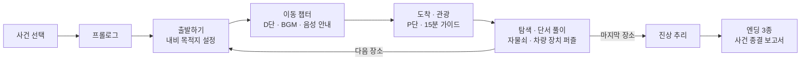

<<<<<<< HEAD
<div align="center">
=======
# EscapeRoad

**차량으로 관광 명소를 하나의 이야기로 연결하는 스토리 방탈출 여행 앱입니다.** 팀 **D2E**가 Pleos Connect용으로 개발하며, 첫 사건 「시역(屍疫)」은 수원 5개 장소에서 관광 → 퍼즐 → 제출 → 단서 획득 → 저장·재개로 이어집니다.

앱 이름은 **EscapeRoad**입니다. 앱 ID는 `com.team.carescape`, 현재 버전은 `0.4.0` (`versionCode=4`)입니다.

## 제출용 Release APK

> **D2E 제출용 서명 Release APK**입니다. 시연 위치를 명시적으로 입력하는 REVIEW 모드를 제공하며, 실제 반경 검사·15분 대기·차량 SDK 안전 조건을 유지합니다. 검증한 범위와 제외 항목은 아래에 구분합니다. 접수 페이지·메일 제출은 팀이 진행합니다.

| 항목 | 내용 |
| --- | --- |
| 소스 저장소 | [aemizastudy-oss/EscapeRoad](https://github.com/aemizastudy-oss/EscapeRoad) |
| 작업 브랜치 | `release/v0.4.0` |
| 최종 제출 커밋 | 최종 커밋·푸시 후 `git rev-parse HEAD`로 확인해 접수 메일과 GitHub Release 본문에 기록 |
| APK 파일명 | `D2E_EscapeRoad_release.apk` |
| APK 내려받기 | [Release 페이지](https://github.com/aemizastudy-oss/EscapeRoad/releases/tag/v0.4.0-submission) · [APK 다운로드](https://github.com/aemizastudy-oss/EscapeRoad/releases/download/v0.4.0-submission/D2E_EscapeRoad_release.apk) |
| 저장소 내 APK 안내 | [apk/README.md](apk/README.md) |
| APK SHA-256 | `0e5f93dc6eb564a5687ecc586607920d92ded88edd3258237267cccba23cbf8b` |
| 서명 인증서 SHA-256 | `303cea1b55209e766b3e78d2a294dfe7bf1aa91ee399080670b437c722873065` |
| 제출 APK 설치·실행 | 최종 서명 Release를 새 Pleos 에뮬레이터에 설치·실행하고 실제 SDK의 P·정지·UX 허용 상태에서 관광 위치 시연을 선택해 화성행궁 반경 밖 입력 차단, 수동 관광 시작, 실제 15분 카운트와 조기 복귀 차단을 확인했습니다. 앱 강제종료·재실행 후 수사 재개로 같은 관광 단계와 남은 시간(약 15분에서 약 13분)이 이어졌습니다. |

APK는 119252036바이트(약 119.3 MB)로, **GitHub Releases의 첨부 파일**로 제공합니다. 제출 페이지에는 위 저장소와 최종 Release 페이지 주소를 입력하고, 접수 메일에는 저장소 주소와 최종 커밋 번호를 적습니다. 서명키·비밀번호·개인 SDK 경로는 저장소에 포함하지 않습니다.

## 실행 환경과 필요한 설정

| 구분 | 확인된 환경·설정 |
| --- | --- |
| 테스트 OS | Windows 11 |
| 차량 에뮬레이터 | Pleos Connect **v2.1.0** |
| Android 버전 | Android Automotive OS, **API 34** |
| 화면 규격 | **2560 × 1440**, **160 dpi**, 가로 화면 |
| 기존 검증 기기 식별자 | `emulator-5554`, Android 사용자 `10` |
| 개발 도구 | Android Studio, JBR 25, AGP 9.0.1, Kotlin 2.2.21, Gradle 9.1.0 |
| Android 빌드 설정 | compileSdk 36 / targetSdk 34 / minSdk 28, JVM 대상 17 |
| 외부 서비스 인증 | 현재 공모전용 실행 경로에는 네이버 Maps·지역 검색·TourAPI 인증키가 필요하지 않음 |
| 차량 입력 | Pleos Vehicle SDK의 기어·속도·방향지시등·창문·좌석별 독서등 등 실제 지원 신호 |
| 심사용 체험 입력 | REVIEW: 사용자가 입력한 시연 위치로 실제 좌표·반경을 검사하며, 실제 15분 대기 유지 |
| 조작 허용 | 앱 foreground, 최신 P·실제 정지·CarUx 이용 허용을 확인해야 함 |

일반 Android 스마트폰에서 Pleos 서비스와 차량 기능을 사용할 수 있다고 가정하지 않습니다. Ubuntu용 빌드 명령은 아래에 제공하지만, Ubuntu 실행과 실차 주행은 검증하지 않았습니다.

## APK 설치와 실행

아래 순서로 제출용 APK를 실행합니다. 기기에서 확인한 단계와 아직 확인하지 않은 범위는 검증 표를 참고하세요.

1. 위 표의 Release 페이지에서 `D2E_EscapeRoad_release.apk`를 내려받습니다. Pleos Connect v2.1.0 에뮬레이터를 실행하고 설치 대상과 Android 사용자를 확인합니다.
2. APK를 에뮬레이터에 설치합니다. 아래 명령의 기기 ID와 사용자 번호는 기존 검증 환경의 예시입니다.

   ```powershell
   adb -s emulator-5554 install --user 10 -r D2E_EscapeRoad_release.apk
   adb -s emulator-5554 shell am start --user 10 -n com.team.carescape/.MainActivity
   ```

3. Pleos Virtual Console에서 차량 상태를 **P·속도 0**으로 설정하고 실제 SDK 상태가 앱에 전달되는지 확인합니다. 앱의 **SDK 상태 → 권한 확인**에서 플랫폼이 허용하는 권한을 요청합니다. 콘솔 표시만으로 앱이 같은 상태를 수신했다고 판단하지 않습니다.
4. 안전 정차한 로비에서 오른쪽 위 **실행 모드 → 관광 위치 시연**을 선택하고 **사건 고르기 → 시역 → 여행 시작**으로 진행합니다. REVIEW는 LIVE·MOCK와 진행 기록을 분리합니다.
5. **시연 이동 화면 열기**를 누른 뒤 오른쪽 위 체험 설정을 엽니다. **목적지 위치 입력**으로 현재 장소의 시연 위치를 직접 입력하고 설정 창을 닫습니다. 입력한 위도·경도와 목적지의 **실제 거리·반경 조건**을 검사합니다. 반경 밖 위치를 입력하면 최초 도착·관광 시작이 차단돼야 합니다. 이 위치는 실제 차량 GPS 방문 인증이 아닙니다.
6. 목적지 반경과 P·정지·CarUx·foreground 조건을 충족하면 사용자가 **관광 시작**을 눌러 실제 시작 시각을 저장합니다. **실제로 15분을 기다립니다.** 시간 생략·자동 관광 시작·자동 출발은 제공하지 않습니다.
7. 관광 시작 후 15분이 지나면 안전 정차 상태에서 **차로 돌아왔어요**를 누릅니다. 방향지시등·창문·독서등 문제는 콘솔에서 실제 SDK 신호를 입력하고, 앱에서 **제출**합니다. 정답·단서·진행 기록을 함께 저장하며 재실행 후에도 이어갈 수 있습니다.

**REVIEW의 데이터 경계:** 시연 위치만 사용자가 입력하며, 위치 조건과 실제 15분 대기는 생략하지 않습니다. 차량 P·정지·CarUx·foreground와 차량 퍼즐 답안은 실제 SDK에서 받습니다. REVIEW에서의 진행을 실차 방문 인증이나 일반 LIVE 기록으로 합치지 않습니다. 화면에는 **위치 시연 / 실제 15분**이 표시됩니다.

기존 Debug 앱과 신규 Release APK는 서명이 다를 수 있어 같은 앱 ID로 업데이트 설치가 거부될 수 있습니다. 기존 여행 기록을 보존하고, 서명이 일치하는 설치본 또는 별도의 검증 환경에서 설치 여부를 확인합니다.

## 실행 모드와 관광 조건

| 모드 | 위치·차량 입력과 사용 목적 |
| --- | --- |
| LIVE | 실제 Pleos 위치·차량 SDK를 사용하는 일반 경로. 최초 위치 정확도 제한은 아래 참고 |
| REVIEW | 심사용 체험 경로. 명시적으로 입력한 시연 위치의 위도·경도·반경 검사와 실제 15분 대기를 유지하고, 안전 상태·차량 퍼즐 답안은 실제 SDK 사용 |
| MOCK | 기존 Debug 개발·회귀용 모의 입력. 기존 Debug 명시적 시간 생략·자동 시연 주행은 REVIEW 기능이 아님 |

REVIEW의 진행 기록은 LIVE·MOCK와 구분하며, 모드 전환은 안전 정차한 로비에서 진행합니다. 임의의 SDK 미수신을 P·정지로 간주하지 않습니다.

| 단계 | 적용 조건 |
| --- | --- |
| 최초 도착·관광 시작 | 목적지 반경 기본 500m, 최신 위치·정확도·P·정지·CarUx·foreground·정상 시계 |
| 관광 시간 | 사용자가 관광 시작을 누른 실제 시각부터 계산. 반경 밖 이동·GPS 단절만으로 멈추거나 초기화하지 않음 |
| 복귀·문제 입력·제출 | 현재 모드·챕터의 유효한 관광 시작 기록, 최소 15분, 정상 시계, P·정지·CarUx·foreground. 위치는 다시 요구하지 않음 |
| 다음 장소 관광 시작 | 새 장소의 위치와 안전 조건을 다시 확인 |

관광 시작 후 15분은 목적지 반경 안에 연속으로 머물렀다는 위치 증명이 아닙니다. 복귀는 사용자가 버튼으로 요청하며, 15분 경과나 탑승 신호만으로 다음 화면을 자동으로 열지 않습니다. 세부 계약은 [관광 시작과 복귀 정책](docs/tour-return-policy.md)을 따릅니다.

**현재 일반 LIVE의 최초 관광 시작 제한:** Pleos FusedLocation의 미터 정확도 계약을 확인하지 못해 어댑터가 `accuracyMeters=null`을 설정합니다. 최초 위치 정책은 정확도 미상을 허용하지 않으므로, 실제 위치 표본이 수신돼도 관광 시작이 보류됩니다. REVIEW의 명시적 시연 위치 입력은 이 SDK 계약을 확정하거나 일반 LIVE 위치 인증을 해결한 결과가 아닙니다.

SDK의 READY는 연결 준비 상태입니다. 실제 위치 인증, 차량 답안 수신, 길 안내 완료, 가청 음성 출력은 각각 확인해야 합니다. Pleos Connect v2.1.0에서는 온디바이스 TTS의 `ON_DEVICE_ENGINE_ERROR`를 관찰했으며, 음성·배경음의 실제 청취 품질과 실차 주행 결과를 빌드 성공으로 대신하지 않습니다.

## 검증 범위

**제출용 변경의 최신 결과**

| 항목 | 확인 결과 |
| --- | --- |
| 단위 테스트 | **215개 통과**, 실패·오류·skip 0. REVIEW 좌표·반경·실제 15분 경계·모드/안전/시계 조건 포함 |
| Debug·Release·기기 테스트 APK 빌드 | 통과 |
| 신규 UI 테스트 | Debug plain Compose 테스트 **2개 통과**. 선택 콜백·위치 입력·비활성화·안내 검증 |
| 최종 Release 서명 | APK Signature Scheme v2 유효, `debuggable=false`, 앱 표시명 `EscapeRoad` 확인 |
| 최종 Release 기기 확인 | 최종 서명 Release를 새 Pleos 에뮬레이터에 설치·실행하고 실제 SDK의 P·정지·UX 허용 상태에서 관광 위치 시연을 선택해 화성행궁 반경 밖 입력 차단, 수동 관광 시작, 실제 15분 카운트와 조기 복귀 차단을 확인했습니다. 앱 강제종료·재실행 후 수사 재개로 같은 관광 단계와 남은 시간(약 15분에서 약 13분)이 이어졌습니다. |
| 검증 제외 | 실제 15분 경과 후 복귀·문제 해제, 차량 퍼즐 전체 입력·제출, 전체 스토리 완주, 실차 주행·실제 GPS 도착 인증·실제 관광지 방문은 이번 기기 검증에서 확인하지 않았습니다. 시연 좌표를 UI로 입력했으며 시간 우회·앱 상태 파일 주입·가짜 SDK 안전 신호는 사용하지 않았습니다. |

아래는 **관광 복귀 정책 변경 시점의 이전 결과**입니다. 과거 Debug 검증을 최종 Release 완주로 표시하지 않습니다.

| 항목 | 기존 확인 결과 |
| --- | --- |
| Debug·Release·기기 테스트 APK 빌드 | 통과. 당시 Release 산출물은 unsigned |
| 단위 테스트 | 203개 통과, 실패·오류·skip 0 |
| 최근 기기 회귀 | MOCK 위치·안전 fixture를 이용한 2개 통과 |
| 실제 SDK 자물쇠 시연 | 이전 Debug 격리 LIVE 세션에서 5개 장소·23개 자물쇠와 저장·재개 확인. 위치·관광 대기 제외 조건을 사용한 결과 |

| 실제 LIVE 최초 도착·실차·Ubuntu | 미확인 또는 제외. 최초 위치 정확도 문제는 위 제한 참고 |

회차별 APK·SDK·기기 환경과 성공·제외 항목은 [검증 로그](docs/verification-log.md)에 기록합니다. 아래 상세 기록의 과거 테스트 수치와 현재 제출 APK 검증을 구분합니다.

## 소스 코드로 빌드하기

Android Studio에서 저장소 최상위 폴더를 열어 Gradle Sync를 진행합니다. Android SDK Platform 36과 `android.car` 컴파일 라이브러리, Pleos Maven 저장소 접근이 필요합니다. 개인 SDK 경로는 Git에서 제외하는 `local.properties`에 설정합니다.

개발·검증용 Debug 빌드:

```powershell
.\gradlew.bat :app:testDebugUnitTest :app:assembleDebug
```

```bash
chmod +x gradlew
./gradlew :app:testDebugUnitTest :app:assembleDebug
```

Debug APK는 `app/build/outputs/apk/debug/app-debug.apk`에 생성됩니다. Android Studio에서 `app` 실행 구성과 Pleos 에뮬레이터를 선택해 Run합니다.

Release 서명은 로컬의 `keystore.properties`가 있을 때 적용합니다. [keystore.properties.example](keystore.properties.example)의 `storeFile`, `storePassword`, `keyAlias`, `keyPassword`를 본인 환경에 맞게 작성합니다. `storeFile`에는 저장소 밖의 release 키 경로를 지정합니다. 실제 키·비밀번호가 든 파일은 Git에서 제외하며, 키가 없는 다른 PC에서는 자신이 소유한 별도 키로 재현 빌드할 수 있습니다.

Windows PowerShell:

```powershell
.\gradlew.bat :app:testDebugUnitTest :app:assembleRelease
```

Ubuntu:

```bash
chmod +x gradlew
./gradlew :app:testDebugUnitTest :app:assembleRelease
```

로컬 서명 설정이 없으면 unsigned 산출물이 생성될 수 있으며, `app-release-unsigned.apk`는 실행 가능한 제출 APK로 사용하지 않습니다. 서명된 산출물은 `app/build/outputs/apk/release/app-release.apk`이며, 제출 파일명은 `D2E_EscapeRoad_release.apk`입니다. 파일 해시는 [SHA256SUMS.txt](apk/SHA256SUMS.txt), 서명·검증 절차는 [제출용 Release 안내](docs/submission-release.md)를 참고하세요.

제출할 소스의 최종 커밋 번호는 커밋·푸시 후 아래 명령으로 확인해 접수 메일과 GitHub Release 본문에 기록합니다.

```bash
git rev-parse HEAD
```

## 구현·개발용 시연 상세

아래는 기존 구현 및 Debug용 시연 안내입니다. **아래의 Release LIVE 전용·개발 패널 제외 설명은 REVIEW 추가 전의 이력이며, 실행 모드·서명·제출 방법은 위 현행 제출용 항목이 우선합니다.** 과거 통합 당시의 테스트 숫자는 해당 시점의 기록입니다. Debug 격리 LIVE 검증 세션의 위치·시간 예외는 REVIEW에 적용하지 않습니다.

<details>
<summary>기존 통합 스토리·자물쇠·Debug 시연·SDK 연결 상세 펼치기</summary>

>>>>>>> afa312750eb014eb568dd561ab7eb69c24131a39


# Escape Road · 이스케이프 로드

**Escape Room에서 Escape Road로, 도시 전체를 무대로 달리는 스토리 방탈출 여행 패키지**

`Pleos Connect` · `Android Automotive (API 34)` · `Kotlin` · `Jetpack Compose`

<<<<<<< HEAD
현대자동차그룹 차량용 앱 개발 공모전 출품작 · 팀 D2E (Drive to Escape)
=======
### 2026-11-15 공모전용 구성
>>>>>>> afa312750eb014eb568dd561ab7eb69c24131a39

[▶ 시연 영상](https://www.youtube.com/watch?v=8HCgqPB_IQw) · [📦 APK 다운로드](https://github.com/aemizastudy-oss/EscapeRoad/releases/tag/v0.4.0) · [실행 방법](#7-실행-방법)

</div>

<<<<<<< HEAD
<p align="center">
  
</p>
=======
### 통합 스토리 진행
>>>>>>> afa312750eb014eb568dd561ab7eb69c24131a39

> [!NOTE]
> **현재 상태:** v0.4.0 · `release/v0.4.0` 브랜치 · Pleos Connect 에뮬레이터(v2.1.0, API 34, 2560×1440)에서 확인했습니다. **실차에서는 아직 확인하지 않았습니다.** 확인한 범위와 확인하지 않은 범위는 [검증 상태](#6-검증-상태)에 나눠 적었습니다.

## 🎬 시연 영상

<p align="center">
  <a href="https://www.youtube.com/watch?v=8HCgqPB_IQw">
    
  </a>
  <br>
  <b>▶ <a href="https://www.youtube.com/watch?v=8HCgqPB_IQw">YouTube에서 시연 영상 보기</a></b>
</p>

## 목차

1. [한눈에 보기](#1-한눈에-보기)
2. [왜 만들었나](#2-왜-만들었나)
3. [플레이 흐름](#3-플레이-흐름)
4. [핵심 기능](#4-핵심-기능)
5. [Pleos SDK 활용](#5-pleos-sdk-활용)
6. [검증 상태](#6-검증-상태)
7. [실행 방법](#7-실행-방법) (APK · 테스트 환경 · 설정)
8. [프로젝트 구조](#8-프로젝트-구조)
9. [발전 방향](#9-발전-방향-pleos-sdk로-넓히는-퍼즐)
10. [출처·라이선스](#10-출처라이선스)

---

<<<<<<< HEAD
## 1. 한눈에 보기

| 항목 | 내용 |
=======
### 시연 바로가기 (debug)

debug 빌드의 오른쪽 위 **시연 · SIM** 패널에서 MOCK과 P 정차를 고른 뒤 「시연 바로가기」로 원하는 지점(도착 1~5 · 장면 1~5 · 마지막 공개 · 진/일반/배드 엔딩)에 바로 갈 수 있다. 앞부분을 정답으로 자동 진행한 새 시연 여행으로 바뀐다. 관광 시작 기록이 있는 현재 챕터의 복귀·문제 열기에는 위치 표본을 다시 요구하지 않는다. 새 장소의 관광을 시작하려면 「현재 장소 위치 시연」과 정차 조건을 확인한다.

### 자물쇠 체험

로비의 자물쇠 체험 버튼은 제거했습니다. 내부 체험 화면과 회귀 테스트는 남아 있으며, 네 종류 입력 컴포넌트는 이야기의 문제에서 사용합니다. 이번 화면은 입력 연습이며 기존 시역의 정답·챕터·관광 기록을 바꾸지 않습니다. 화면의 **제출**을 누를 때만 현재 전체 답안을 읽어 표시하며 자동 정답 판정은 하지 않습니다.

| 종류 | 조작 |
>>>>>>> afa312750eb014eb568dd561ab7eb69c24131a39
| --- | --- |
| 한 줄 소개 | Escape Room에서 Escape Road로, 도시 전체를 무대로 달리는 스토리 방탈출 여행 패키지 |
| 핵심 개념 | **차량의 콘텐츠화**: 이동 시간은 이야기, 주행 상태는 진행 신호, 차량 장치는 퍼즐 도구가 됨 |
| 안전 원칙 | **P단 플레이**: 주행 중에는 음성과 BGM만, 탐색과 풀이는 P단으로 정차했을 때만 |
| 시연 사건 | 수원 화성 「시역(屍疫)」 · 장소 5곳 · 자물쇠 23개 · 엔딩 3종 · 반나절 코스 |
| 앱 정보 | 앱 ID `com.team.carescape` · 버전 `0.4.0` (versionCode 4) |

## 2. 왜 만들었나

| 키워드 | 주목한 점 | 이스케이프 로드의 답 |
| --- | --- | --- |
| 차와 함께하는 여행 | 국내 여행의 84.5%가 자가용으로 이루어지지만(2025 국민여행조사), 차 안 콘텐츠는 대부분 **재생**에 머문다 | 차의 이동·데이터·장치를 콘텐츠 재료로 쓴다 |
| 무대의 확장 | 방탈출이 야외로 넓어졌지만 걸어서 하는 방식이라 **한 동네 코스**를 벗어나기 어렵다 | 차로 흩어진 명소를 하나의 **지역 기반 사건**으로 잇는다 |
| 여행 준비 부담 | 동선을 짜고 주차장·식당을 따로 찾아야 하며, 관광지는 안내판을 읽는 관람형이 많다 | 코스·이야기·주변 정보를 묶은 **사건**과 **여행 도우미** |
| 몰입형 드라이브 | 운전자는 주행 중 화면 콘텐츠에서 빠지게 된다 | 주행 중에는 **음성**, 정차 뒤에는 **다 함께 풀이** |

> "여행지에 가기 위해 차를 탄다"에서 **"여행하기 위해 차를 탄다"**로.

<<<<<<< HEAD
## 3. 플레이 흐름
=======
### 빌드와 실행
>>>>>>> afa312750eb014eb568dd561ab7eb69c24131a39



| 사건 선택 | 사건 기록부 | 사건 종결 보고서 |
| :---: | :---: | :---: |
|  |  |  |

> Pleos Connect 에뮬레이터 Debug 빌드에서 찍은 화면입니다. 오른쪽 위 `시연 · SIM` 버튼은 Debug 전용이며 Release에는 없습니다.

📖 사건 「시역(屍疫)」의 전체 이야기와 장면 구성은 [**시역 스토리보드 (PDF)**](docs/story/siyeok-storyboard.pdf)에서 볼 수 있습니다.

## 4. 핵심 기능

### 🚗 P단 플레이 원칙

- 앱이 **기어·속도·운전 중 화면 제한(CarUx) 상태**를 직접 읽습니다. 탐색·자물쇠·여행 도우미는 `P단 + 정지 + CarUx 허용 + 앱 화면 표시` 조건을 모두 만족할 때만 열립니다.
- 풀이 도중 D단이 들어오면 즉시 차단 화면으로 바뀌고, 입력하던 답안은 초기화됩니다.
- 도착해도 앱 화면을 강제로 띄우지 않습니다. 중요도가 낮은 알림만 띄우고, 이용자가 정차한 뒤 눌러서 돌아옵니다.

### 🎧 이동 챕터

- **출발하기**를 누르면 NaviHelper로 다음 장소가 내비게이션 목적지로 설정됩니다.
- D단으로 출발하면 포그라운드 서비스가 **장소별 BGM**과 **진행자 음성**(출발할 때 1회, 도착 약 900m 전 1회)을 재생합니다.
- 내비 안내·통화·차량 음성이 나오면 앱 소리를 잠시 멈췄다가 이어서 재생합니다. 오른쪽 위 버튼으로 음성을 끌 수 있습니다.

### 🏯 도착 · 관광 · 탐색

- 장소마다 시간대가 다른 **사건 장면**과 **15분 관광 가이드**(꼭 볼 것 3가지·사진 명소)를 제공합니다.
- 관광을 시작하고 15분이 지나야 탐색이 열립니다. 차 안에서만 문제를 푸는 것을 막는 장치입니다.
- 탐색 장면에서 사물을 눌러 조사하고 자물쇠를 풉니다. 단서를 찾을수록 새로운 공간이 열립니다.

| ① 화성행궁 · 해 질 녘 | ② 화홍문 · 밤 | ③ 만석거 · 새벽 |
| :---: | :---: | :---: |
|  |  |  |
| **④ 수원광교박물관 · 2026년 수장고** | **⑤ 광교호수공원 · 아랫방죽** | |
|  |  | |

### 🔐 차량 장치 퍼즐: 차 안에서만 풀 수 있는 문제

| 장소 | 퍼즐 | 차량 장치 (Vehicle SDK) |
| --- | --- | --- |
| 화홍문 | 일곱 칸 판문을 오른쪽(닫기)·왼쪽(열기) 깜빡이로 차례로 정하기. 모두 닫으면 함정 | 방향지시등 (TurnSignal) |
| 수원광교박물관 | 앞·뒤 좌우 독서등을 켜서 봉화 올리기 | 독서등 4개 영역 (Light) |
| 광교호수공원 | 운전석 창문을 내려 물소리 듣기 | 창문 (Window) |

앱은 차량 상태를 **읽기만** 하고 차량을 제어하지 않습니다. 차량 장치 입력도 P단에서만 받습니다.

### 🧩 단서 · 힌트 · 엔딩

- **자물쇠:** 숫자·방향·색상·영어·한자 다이얼·시간 다이얼·소지품 사용 등 여러 형태가 있습니다. 화면의 **제출**을 눌렀을 때만 정답을 판정합니다.
- **소지품 · 사건 기록부:** 획득한 물건은 다른 장소에서 쓰고, 인물 일지와 문서는 사건 기록부의 문서·인물·소지품·단서 탭에서 다시 읽을 수 있습니다.
- **3단계 힌트 + 각성도:** 1단계는 방향 제시, 2단계는 구체적 단서, 3단계는 결정적 힌트입니다. 힌트 2·3단계와 함정은 각성도(10단계)를 올립니다.
- **엔딩 분기:** 각성도와 진상 추리 결과에 따라 진 엔딩 「연이의 이름」, 일반 엔딩 「한 장이 비어 있다」, 배드 엔딩 「호숫가의 그림자」로 나뉩니다.
- **저장 · 재개:** 진행·오답·힌트 기록을 기기에 저장합니다. 앱을 다시 켜면 **수사 재개**로 이어서 할 수 있습니다.
- **사건 종결 보고서:** 수사 시간·힌트·오답·각성도·장소별 기록을 한 장으로 정리하고 사진으로 저장합니다.

### 🧭 여행 도우미

| 탭 | 내용 |
| --- | --- |
| 일정 | 날짜·기간(당일치기~2박 3일)·관심사를 입력하면 사건 코스에 맞춘 일정 제공 |
| 장소 카드 | 직접 확인해 준비한 카드 40개(주차·맛집·카페·체험·숙소·야경). 주소와 출처 표기 |
| 15분 가이드 | 장소별 관람 체크리스트. 사건에 쓰이는 항목은 `사건 단서`로 표시하고 정답은 숨김 |
| 내 차 | Vehicle SDK로 읽은 배터리·연료·주행 가능 거리를 남은 코스와 비교해 충분/빠듯/충전 필요로 판정 |

- 공개 전인 마지막 장소는 스포일러를 막기 위해 가립니다.
- 길 안내는 **관광지 대표 지점까지** Pleos NaviHelper로 요청합니다. 식당이나 주차장 입구까지 안내하지는 않습니다.
- **외부 지도·검색 API를 쓰지 않습니다.** 앱(main) 코드에는 외부 서버와 통신하는 코드도 `INTERNET` 권한도 없습니다. 장소 카드의 공식 사이트 주소는 출처를 밝히려고 도메인만 글자로 보여주며, 앱이 접속하지는 않습니다.

## 5. Pleos SDK 활용

| SDK | 쓰는 곳 | 코드 |
| --- | --- | --- |
| **Vehicle** (2.3.2) | 주행 중 서비스의 기어 감지(D단 출발 → 이동 챕터 시작) | [DriveSignals.kt](app/src/main/java/com/team/carescape/drive/DriveSignals.kt) |
|  | 방향지시등 · 창문 · 와이퍼 상태 | [PleosVehiclePuzzleReader.kt](app/src/main/java/com/team/carescape/platform/sdk/PleosVehiclePuzzleReader.kt) |
|  | 독서등(Light) 봉화 퍼즐 | [PleosInteriorLightReader.kt](app/src/main/java/com/team/carescape/platform/sdk/PleosInteriorLightReader.kt) |
|  | 배터리 · 연료 · 주행 가능 거리 · 브레이크 | [PleosVehicleAssist.kt](app/src/main/java/com/team/carescape/platform/sdk/PleosVehicleAssist.kt) |
| **NaviHelper** (3.0.5) | 다음 장소 목적지 설정, 남은 거리 기반 안내 시점, 내비 화면 전환 | [PleosLocationNavigation.kt](app/src/main/java/com/team/carescape/platform/sdk/PleosLocationNavigation.kt) · [DriveSignals.kt](app/src/main/java/com/team/carescape/drive/DriveSignals.kt) |
| **FusedLocation** (1.1.3) | 장소 도착 판정, 주행 중 도착 감지 | [PleosLocationNavigation.kt](app/src/main/java/com/team/carescape/platform/sdk/PleosLocationNavigation.kt) · [DriveSignals.kt](app/src/main/java/com/team/carescape/drive/DriveSignals.kt) |
| **TextToSpeech** (3.3.1, ON_DEVICE) | 진행자 음성 (녹음 파일이 없을 때 사용) | [PleosSpeechAdapter.kt](app/src/main/java/com/team/carescape/platform/sdk/PleosSpeechAdapter.kt) · [DriveAudio.kt](app/src/main/java/com/team/carescape/drive/DriveAudio.kt) |
| **SpeechToText** (3.3.1, ON_DEVICE) | 연결 어댑터만 준비. 현재 사건에는 음성 입력 화면 없음 | [PleosSpeechAdapter.kt](app/src/main/java/com/team/carescape/platform/sdk/PleosSpeechAdapter.kt) |
| Android Car API | 앱 화면의 P단 · 속도 · CarUx 안전 판정 | [PleosCarSafety.kt](app/src/main/java/com/team/carescape/platform/sdk/PleosCarSafety.kt) |

- 사용하는 의존성은 [app/build.gradle.kts](app/build.gradle.kts), 권한은 [AndroidManifest.xml](app/src/main/AndroidManifest.xml)에서 확인할 수 있습니다.
- 음성은 기기 안에서만 처리합니다. 차량 마이크나 음성을 외부 서비스로 보내지 않습니다.
- SDK 연결·권한·제약의 자세한 내용은 [SDK 연결 안내](docs/sdk-ui-integration.md)와 [차량 퍼즐 SDK](docs/vehicle-puzzle-sdk.md)에 있습니다.

## 6. 검증 상태

| 구분 | 결과 |
| --- | --- |
| 빌드 | Debug · Release · 기기 테스트 APK 빌드 성공 |
| 단위 테스트 | **203개 통과** (실패 0) |
| LIVE SDK 완주 | Pleos 에뮬레이터와 Virtual Console로 실제 SDK 신호를 넣어 **자물쇠 23개를 전부 풀고 진 엔딩·저장·재개까지 확인** (위치 인증·15분 대기는 제외) |
| 차량 신호 수신 | 방향지시등 · 창문 · 독서등 4개 영역 · 와이퍼 · 기어/속도 값이 앱에 들어오는 것 확인 |
| 아직 확인하지 않은 것 | 실차 주행, 실제 관광지 방문 인증(위치 정확도 근거 부족으로 보류), 내비 길 안내 완료, 음질·음량 청취 확인, 서명된 Release APK |

자세한 날짜별 기록은 [검증 로그](docs/verification-log.md)에 있습니다.

## 7. 실행 방법

### 📦 APK

| 구분 | 위치 |
| --- | --- |
| 바로 설치 | **[GitHub Release v0.4.0](https://github.com/aemizastudy-oss/EscapeRoad/releases/tag/v0.4.0)** › `EscapeRoad-v0.4.0-debug.apk` (약 128MB, 시연 패널 포함 Debug 빌드) |
| 직접 빌드 | `app/build/outputs/apk/debug/app-debug.apk` (아래 빌드 명령 실행 후 생성) |

> APK가 GitHub 저장소 파일 크기 제한(100MB)을 넘어서 저장소가 아닌 Release에 올립니다.

### 🖥️ 개발·테스트 환경

| 항목 | 내용 |
| --- | --- |
| 에뮬레이터 | **Pleos Connect v2.1.0** (AVD `Pleos_Connect_v2.1.0`, x86_64) |
| OS | Android 14 (API 34), Android Automotive |
| 화면 규격 | **2560 × 1440** (가로), 160dpi |
| 개발 PC | Windows 11 · Android Studio (내장 JBR) |
| 빌드 설정 | compileSdk 36 · targetSdk 34 · minSdk 28 · Java 17 · AGP 9.0.1 |
| 차량 신호 테스트 | Pleos **Virtual Console** (방향지시등·창문·독서등·기어·속도 입력) |

### ⚙️ 필요한 설정

1. **Android Studio**에서 저장소 최상위 폴더를 열고 Gradle Sync를 합니다.
2. SDK Manager에서 **Android SDK Platform 36**을 설치합니다. `android.car` 라이브러리는 이 플랫폼에 들어 있습니다.
3. Pleos SDK는 [Pleos Maven 저장소](https://nexus-playground.pleos.ai/repository/maven-releases/)에서 받습니다. 이미 [settings.gradle.kts](settings.gradle.kts)에 등록돼 있어서 별도 계정 설정은 필요 없습니다.
4. `local.properties`에는 Android SDK 경로(`sdk.dir`)만 둡니다. Android Studio가 자동으로 만들고, 저장소에는 올리지 않습니다.
5. Pleos Connect 에뮬레이터(v2.1.0)를 설치하고 실행합니다.
6. 앱 권한(차량 조명·창문·주행 상태·위치·내비·TTS 등)은 [AndroidManifest.xml](app/src/main/AndroidManifest.xml)에 선언돼 있습니다. 에뮬레이터에서는 설치하면 바로 쓸 수 있습니다.

### ▶️ 빌드 · 설치 · 실행

```powershell
# Windows: 단위 테스트 + Debug APK 빌드
.\gradlew.bat :app:testDebugUnitTest :app:assembleDebug
```

```bash
# macOS / Linux (Ubuntu에서는 아직 실행해 보지 않음)
chmod +x gradlew
./gradlew :app:testDebugUnitTest :app:assembleDebug
```

```powershell
# 에뮬레이터에 설치하고 실행 (Pleos 에뮬레이터 사용자는 10번)
adb install -r app/build/outputs/apk/debug/app-debug.apk
adb shell am start --user 10 -n com.team.carescape/.MainActivity
```

<<<<<<< HEAD
- Android Studio에서는 `app` 실행 구성을 고르고 Pleos 에뮬레이터를 대상으로 **Run**하면 됩니다.
- 일반 Android 휴대폰에서는 Pleos 서비스와 차량 기능이 없어서 정상 동작을 보장하지 않습니다.
=======
### DEBUG 시연과 재개
>>>>>>> afa312750eb014eb568dd561ab7eb69c24131a39

### 🎮 시연 방법 (Debug 빌드)

실제로 이동하지 않고 전체 흐름을 볼 수 있습니다.

<<<<<<< HEAD
1. 오른쪽 위 **시연 · SIM** 패널에서 **MOCK**과 **P 정차**를 선택합니다.
2. 사건 고르기 → 「시역」 → 프롤로그 → **출발하기**를 누르면 약 1분짜리 **시연 자동 주행**이 진행됩니다.
3. **시연 바로가기**로 도착 1~5, 장면 1~5, 마지막 공개, 엔딩 3종 중 원하는 지점으로 바로 이동할 수 있습니다.
4. 차량 장치 퍼즐은 SIM 패널 버튼이나 Pleos **Virtual Console**로 조작합니다. 자세한 방법은 [LIVE SDK 콘솔 테스트](docs/live-sdk-console-test.md)에 있습니다.
=======
### 실제 SDK 확인
>>>>>>> afa312750eb014eb568dd561ab7eb69c24131a39

> Release 빌드에는 시연 패널·모의 P단·시간 생략 기능이 들어 있지 않습니다.

<<<<<<< HEAD
## 8. 프로젝트 구조

```text
app/src/main/java/com/team/carescape/
├── game/          # 사건 진행 엔진 · 「시역」 콘텐츠 · 자물쇠/퍼즐 판정 · 관광 정책
├── drive/         # 주행 중 포그라운드 서비스 · BGM/음성 · 도착 감지
├── platform/sdk/  # Pleos SDK · Android Car API 연결 (5번 표 참고)
├── travel/        # 여행 도우미 · 장소 카드 · 15분 가이드 · 내 차 계획
├── data/          # 여행 진행 저장 (DataStore)
└── ui/            # Compose 화면 · locks/ 재사용 자물쇠 컴포넌트
```

## 9. 발전 방향: Pleos SDK로 넓히는 퍼즐

지금은 방향지시등·독서등·창문 3가지 장치로 퍼즐을 풉니다. 아래는 **Pleos Connect 공식 문서에서 해당 API가 공개돼 있는 것을 확인한 항목만** 골랐습니다. 모두 아직 구현하지 않은 계획입니다.

- 차량 값은 **읽기만** 합니다. 차량을 제어하는 API(공조 설정, 무드등 색 변경 등)는 Pleos App Market 권한 승인이 필요해서 제외했습니다.
- 차량 입력은 지금처럼 **P단 정차 중에만** 받습니다.
- 공모전 [개발 범위 공지](https://appdevchallenge.auto-hmg.io/notice/c0a1a000-2026-4923-8000-000000000008)에서 허용한 SDK(Vehicle · NaviHelper · TextToSpeech · SpeechToText · FusedLocation)와 Gleo Interface만 씁니다.

### 🔐 새로운 차량 장치 퍼즐

| 아이디어 | 퍼즐 예시 | 쓸 API (공식 문서) |
| --- | --- | --- |
| 비 내리는 장면 | 와이퍼를 켜야 유리창 너머 단서가 드러남. 와이퍼 신호 수신은 이미 에뮬레이터에서 확인함 | [Vehicle · Wiper](https://document.pleos.ai/docs/pleos-only/connect-sdk-pleos/Vehicle/vehicle/ai.pleos.playground.vehicle.api/wiper/entry) `getCurrentWiperState` |
| 봉화 신호 | 전조등을 켜고 끄는 횟수로 신호 보내기 | [Vehicle · Light](https://document.pleos.ai/docs/pleos-only/connect-sdk-pleos/Vehicle/vehicle/ai.pleos.playground.vehicle.api/light/entry) `getCurrentLowBeamLightState` |
| 얼음 창고의 온도 | 단서에서 찾은 숫자로 에어컨 설정 온도를 맞추면 상자가 열림. 앱은 설정값을 읽기만 함 | [Vehicle · HVAC](https://document.pleos.ai/docs/pleos-only/connect-sdk-pleos/Vehicle/vehicle/ai.pleos.playground.vehicle.api/h-v-a-c/get-hvac-temperature) `getHvacTemperature` |
| 의자의 각도 | 일지에 적힌 각도대로 좌석 등받이를 기울이기 | [Vehicle · Seat](https://document.pleos.ai/docs/pleos-only/connect-sdk-pleos/Vehicle/vehicle/ai.pleos.playground.vehicle.api/seat/get-current-seat-backrest-angle-position) `getCurrentSeatBackrestAnglePosition` |
| 돌아온 요원 | 관광 후 문이 열렸다 닫히면 "차로 돌아왔어요"를 자동 인식 | [Vehicle · Door](https://document.pleos.ai/docs/pleos-only/connect-sdk-pleos/Vehicle/vehicle/ai.pleos.playground.vehicle.api/door/get-current-door-position) `getCurrentDoorPosition` |
| 탑승 인원별 역할 | 앉은 사람 수에 맞춰 단서와 역할을 나눠 줌 | [Vehicle · Seat](https://document.pleos.ai/docs/pleos-only/connect-sdk-pleos/Vehicle/vehicle/ai.pleos.playground.vehicle.api/seat/get-current-seat-occupancy) `getCurrentSeatOccupancy` |

### 🗺️ 위치 · 길 안내로 넓히는 퍼즐

| 아이디어 | 퍼즐 예시 | 쓸 API (공식 문서) |
| --- | --- | --- |
| 지나가는 길의 해설 | 사건과 관련된 장소 근처를 지나면 진행자가 해설. 예) "지금 정조의 능행차 길을 지나고 있습니다" | [FusedLocation](https://document.pleos.ai/docs/pleos-only/connect-sdk-pleos/FusedLocation/intro) `addProximityAlert` (구역 진입 알림) |
| 숨은 경유지 | 단서를 풀면 다음 장소 전에 들를 비밀 경유지가 내비에 추가됨 (최대 2곳) | [NaviHelper · 경유지 설정](https://document.pleos.ai/docs/pleos-only/connect-sdk-pleos/NaviHelper/waypoint-settings) `addWaypoint` |
| 달린 거리 봉투 | 사건을 시작하고 일정 거리를 달려야 열리는 봉인 편지. 보고서에 이동 거리 기록 | [Vehicle · Odometer](https://document.pleos.ai/docs/pleos-only/connect-sdk-pleos/Vehicle/vehicle/ai.pleos.playground.vehicle.api/odometer/get-trip-current-driving-distance) `getTripCurrentDrivingDistance` |
| 쉬어 가는 챕터 | 배터리가 부족하면 충전하며 차 안에서 푸는 짧은 챕터를 제안 | [Vehicle · EvBattery](https://document.pleos.ai/docs/pleos-only/connect-sdk-pleos/Vehicle/vehicle/ai.pleos.playground.vehicle.api/ev-battery/get-ev-battery-state-of-charge) `getEvBatteryStateOfCharge` (이미 '내 차' 탭에서 사용 중) |

### 🎙️ 음성으로 함께 푸는 퍼즐

| 아이디어 | 퍼즐 예시 | 쓸 API (공식 문서) |
| --- | --- | --- |
| 동승자 암호 | 이동 중 진행자가 들려준 단서를 기억했다가, 정차 후 암호를 말로 말해 입력 | [SpeechToText](https://document.pleos.ai/docs/pleos-only/connect-sdk-pleos/SpeechToText/intro) ON_DEVICE (어댑터는 이미 연결돼 있음) |
| 음성 힌트 요청 | "힌트 줘", "사건 기록부 열어" 같은 음성 명령으로 앱 기능 실행 | [Gleo Interface (App Schema)](https://document.pleos.ai/docs/pleos-only/app-integration-guide/guide/app-capability) (공지상 별도 승인 없이 사용 가능) |
| 차량 반응형 대사 | 와이퍼·전조등이 켜지면 진행자가 비·밤에 맞는 대사를 읽어 줌 | [TextToSpeech](https://document.pleos.ai/docs/pleos-only/connect-sdk-pleos/TextToSpeech/intro) ON_DEVICE + Wiper · Light |

> 각 Vehicle 기능을 실제 차량이 지원하는지는 [Capability 확인](https://document.pleos.ai/docs/pleos-only/connect-sdk-pleos/Vehicle/check-capability)으로 먼저 확인하고, 지원하지 않으면 화면 입력으로 대신합니다.

### 🧭 서비스 확장

- **사건 추천:** 유형(추리형·스토리형·가족형)·난이도·장르 필터, 현재 위치(FusedLocation)와 주행 가능 거리(Vehicle) 기반 추천
- **기록 · 리뷰:** 사건 종료 후 익명 별점 리뷰
- **지역 확장:** 경주, 공주·부여, 강릉 등. 데이터 파일만 추가하면 새 사건이 생기는 사건 패키지 구조

## 10. 출처·라이선스

| 구분 | 내용 | 출처 · 라이선스 |
| --- | --- | --- |
| 그림 | 인물 7 · 장면 배경 9 · 소품 22 · 자물쇠 4 | 팀 제작 (AI 도구 사용) |
| 음성 | 프롤로그 녹음 17개, 나머지 대사는 Pleos TextToSpeech(ON_DEVICE) | 팀 제작 |
| BGM | 장소·장면별 20곡 + 기본 주행 BGM 1곡 | 팀 제작 / 기본 주행 BGM은 [make_drive_bgm.py](tools/make_drive_bgm.py)로 직접 합성 |
| 폰트 | 나눔명조 · Noto Serif KR · Cormorant SC · Playfair Display · Playfair Display SC · Pinyon Script | SIL Open Font License ([원문](docs/licenses)) |
| 장소 정보 | 여행 도우미 장소 카드 40개 | 지자체·관광 공식 안내 ([장소 출처](docs/curated-places.md)) |

📁 리소스 파일 전체 목록과 미리보기는 **[게임 리소스 문서](docs/assets.md)** 에 있습니다.

> 사건 속 이야기와 인물은 허구입니다. 문제에 쓰인 역사 정보는 공식 자료와 현장 표기로 검수합니다.

**참고 문서**

| 문서 | 내용 |
| --- | --- |
| [시역 스토리보드 (PDF)](docs/story/siyeok-storyboard.pdf) | 사건 전체 줄거리와 장면 구성 |
| [시역 퍼즐판](docs/story-puzzles.md) | 장소별 단계·정답·근거 |
| [주행 챕터](docs/drive-chapter.md) | 이동 중 BGM·음성 동작 규칙 |
| [여행 도우미](docs/travel-guide.md) | 장소 카드 사용법 |
| [공모전 점검](docs/contest-compliance-review.md) | 규정 확인과 남은 확인 사항 |
| [검증 로그](docs/verification-log.md) | 날짜별 빌드·테스트 기록 |
=======
현재 음성은 Pleos ON_DEVICE입니다. 원격의 주행 챕터·배경음악을 병합했으며 이동 중에는 별도 서비스가 짧은 목적지 안내와 BGM을 담당합니다. 정차용 스토리·퍼즐 화면의 안전 제한은 유지합니다. [주행 챕터](docs/drive-chapter.md)의 적용 범위와 검증 이력을 참고하세요. Vehicle은 읽기 전용 battery/brake 보조 상태와 좌우 깜빡이·와이퍼·앞왼쪽 창문 입력을 연결했습니다. 디버그에서 관광은 MOCK, 차량 안전·답안은 실제 SDK로 선택해 콘솔 조작을 검증할 수 있습니다. 이 선택은 LIVE 관광 인증을 대체하지 않습니다. SpeechToText 어댑터는 있지만, 현재 시역에는 음성 정답·녹음 시작 UI가 없습니다. 공모전용 실행 경로에는 외부 장소 검색·지도·음성 서비스 클라이언트가 없습니다. SDK 내부 통신과 Debug 로컬 콘솔 통신은 별도입니다.


</details>
>>>>>>> afa312750eb014eb568dd561ab7eb69c24131a39
